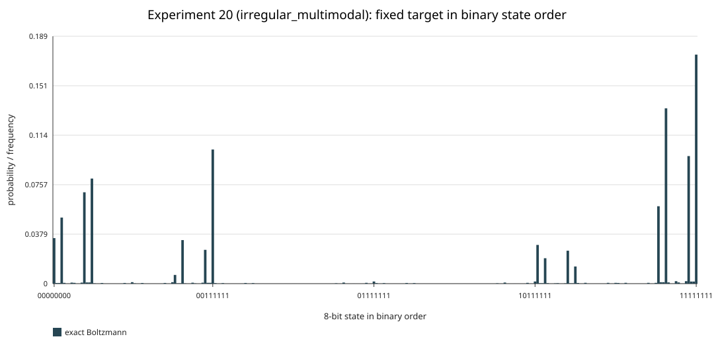
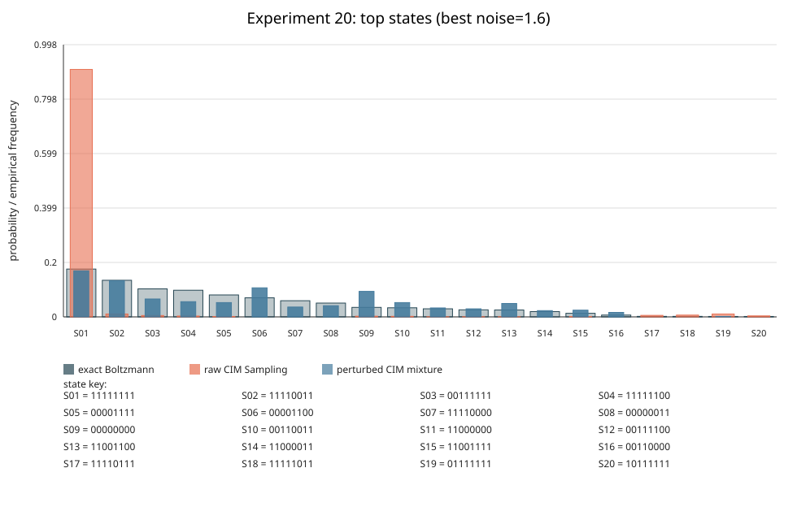
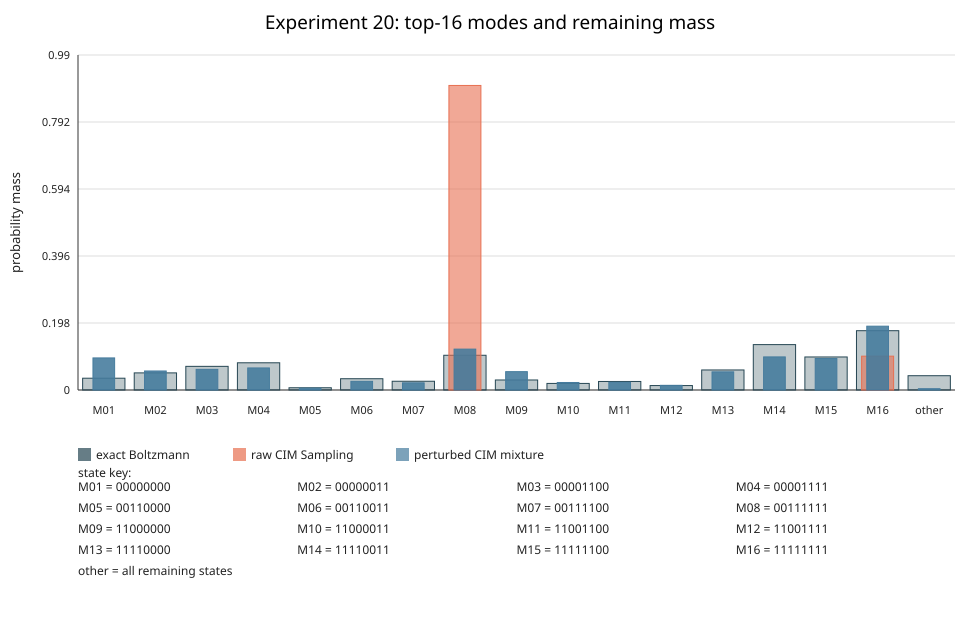
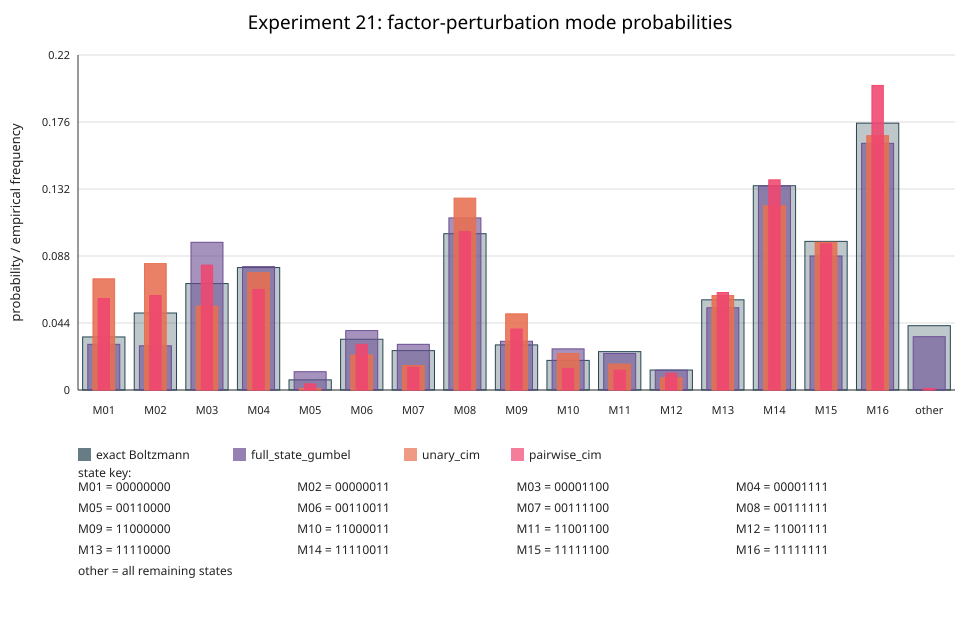
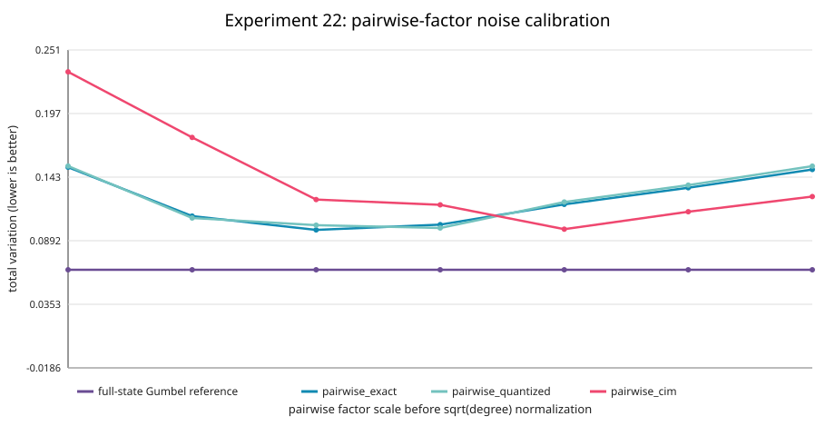
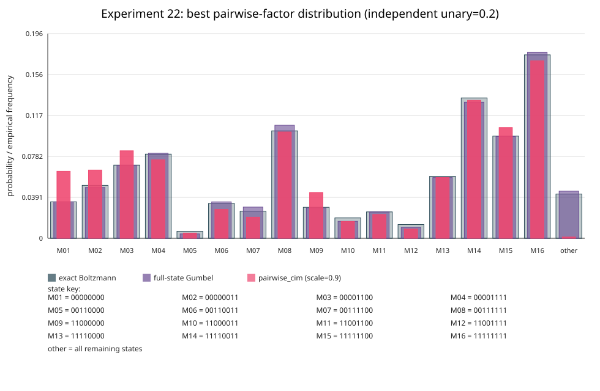

> **一句话结论：**原始CIM Sampling能够找到多个低能态，却不能保证这些状态按照Boltzmann概率出现；对同一个固定Ising模型反复施加随机扰动，每次只取一个低能解，再混合这些解，可以显著改善概率分布。8-bit真机实验中，原始Sampling的TV距离约为0.78，一阶扰动降到0.125，一阶与二阶因子联合扰动进一步降到0.080；但它仍然没有达到Full-state Gumbel精确采样的0.026，说明局部因子扰动是一种有效但不严格的近似。

很多实验并不是从一个宏大的问题开始，而是从一个不太对劲的现象开始。

这次的问题是：**CIM明明能够找到Ising模型的低能状态，为什么用Sampling模式返回的状态频率却和Boltzmann分布差得很远？**

一开始，我把CIM Sampling理解成普通意义上的统计采样：如果请求2000个sample，那么返回状态的出现频率应该近似

$$
p(s)=\frac{\exp[-E(s)/T]}{Z},
\qquad
Z=\sum_{s'}\exp[-E(s')/T]
$$ {#eq-cim-01}

但实验结果并非如此。设备能够找到正确的低能区域，也偶尔返回多个模式，却经常把绝大部分概率集中到一个状态上。增加设备内部的 `sample_number` 会改变返回候选的多样性，但不能稳定恢复目标概率。

这促使我把问题拆成两个不同的目标：

1. **优化问题：**哪个状态的能量最低？
2. **采样问题：**不同状态分别应该以多大概率出现？

CIM天然擅长第一个问题，而Boltzmann Machine训练需要第二个问题。本文记录的是如何尝试在二者之间搭一座桥。

| 模式 | 多次物理演化之后怎么处理 | 目标 |
|---|---|---|
| Optimization | 动态追加大量计算，对候选进行能量排序、聚类和筛选 | 返回更低能、更稳定的优质解 |
| Sampling | 用户指定 `sample_number`，保留多个独立演化结果及其频率 | 观察候选分布，期望采样分布与目标分布一致 |

理想的模式是：
```
                                                                                同样进行多次随机物理演化
                                                                                        │
                                                                                ┌───────┴────────┐
                                                                                ↓                ↓
                                                                        Optimization        Sampling
                                                                        按能量排序、筛选       保留全部样本频率
                                                                        只关心最好的解         关心每个状态出现多少次
```

## 1. 为什么最低能量解不等于Boltzmann样本

本文使用自旋形式的二阶Ising能量：

$$
E(s)
=
-b^\top s
-\frac12s^\top Ws,
\qquad
s_i\in\{-1,+1\}
$$ {#eq-cim-02}

如果只做优化，目标是

$$
s_{\min}=\arg\min_s E(s)
$$ {#eq-cim-03}

设备多次返回同一个最低能量状态，对于优化来说可能完全正确。但统计采样要求的是

$$
s\sim p(s),
\qquad
p(s)\propto \exp[-E(s)/T]
$$ {#eq-cim-04}

低能状态应该更常出现，但不是只有最低能量状态可以出现。有限温度下，次低能状态和高能状态仍然拥有非零概率。

这也是为什么“返回了多少个不同状态”不能单独判断采样好坏。一个采样器可以访问很多状态，但给错它们的频率；也可以只访问主要模式，却漏掉模式周围的重要概率质量。

## 2. 最小实验：构造一个可精确枚举的不规则多峰分布

为了知道误差究竟来自模型、整数编码还是CIM设备，我没有直接使用大规模神经网络，而是先构造一个只有8个自旋的固定Ising模型。

8个自旋一共只有

$$
2^8=256
$$ {#eq-cim-05}

个状态，因此可以枚举全部状态，精确计算每个状态的能量和Boltzmann概率。这给实验提供了一个可靠的“标准答案”。

### 2.1 为什么不是简单双峰

如果目标只有 `00000000` 和 `11111111` 两个对称峰，实验很容易因为问题过于简单而得到乐观结论。因此我把8个自旋组成4个强耦合对：

$$
(s_1,s_2),\ (s_3,s_4),\ (s_5,s_6),\ (s_7,s_8)
$$ {#eq-cim-06}

每一对内部使用强耦合

$$
W_{2k-1,2k}=2.2
$$ {#eq-cim-07}

使同一对中的两个自旋倾向于取相同符号。4个自旋对形成

$$
2^4=16
$$ {#eq-cim-08}

个主要能量谷。随后加入不相等的一阶偏置和组间耦合，使这16个峰拥有不规则、非对称的概率。

这个设置有三个目的：

- 分布确实是普通二阶Ising模型产生的，而不是手工指定一张概率表；
- 状态空间中同时存在多个能量谷，可以观察跨峰能力；
- 256个状态仍可精确枚举，可以把每一种近似误差单独测出来。



图中横轴按照8-bit状态的二进制顺序排列。柱子高度并不单调，因为这是状态顺序，而不是按概率排序。可以看到目标不是规则双峰，而是一组高低不同的主要模式及其周围的小概率状态。

### 2.2 为什么同时看TV和矩统计量

主要分布误差使用总变差距离：

$$
\operatorname{TV}(p,q)
=
\frac12\sum_s|p(s)-q(s)|
$$ {#eq-cim-09}

TV越小越好。它也可以理解为需要重新分配多少概率质量，才能把经验分布变成目标分布。

除此之外，我还记录：

- 一阶矩误差：$\langle s_i\rangle$；
- 二阶矩误差：$\langle s_is_j\rangle$；
- 负相梯度的余弦相似度；
- 拟合得到的有效温度；
- CIM对整数矩阵全局最低点的命中率。

这是因为Boltzmann Machine训练并不一定需要完整概率表，但会直接用到一阶、二阶模型统计量。例如权重梯度中的负相包含

$$
\langle s_is_j\rangle_{\text{model}}
$$ {#eq-cim-10}

因此，一个TV还不完美、但矩统计方向很准确的采样器，仍可能具有训练价值。

### 2.3 实验使用的CIM设备与软件环境

本文的CIM结果不是软件模拟结果，而是通过**玻色量子（QBoson）Kaiwu平台**提交到相干伊辛机服务得到的真机返回。实验环境为：

- Kaiwu SDK版本：`1.4.1`；
- 任务模式：`TaskMode.SAMPLING`；
- Sampling资源规格：`SPQC-550`；
- 单个任务最多使用550个物理自旋；
- 提交对象：经过参考自旋编码和整数化后的对称Ising矩阵；
- 扰动实验中每个打包任务设置 `sample_number=10`；
- 原始Sampling基线单独请求2000个返回样本。

这里的“真机误差”采用一个可复现的操作性定义：对于同一个已经提交的整数矩阵，8-bit逻辑问题可以在CPU上枚举全部256个状态，得到真正的整数全局最低能量；如果CIM返回候选中的最低能状态仍高于这个精确最低值，就记为一次**设备侧搜索未命中**。

这种未命中可能包含玻色CIM物理演化中的随机性、模拟控制与校准误差、有限演化和有限候选数，也可能包含云端求解与返回链路的影响。因此本文可以把它称为广义的“玻色设备侧搜索误差”。

## 3. 第一个异常：原始CIM Sampling不是目标Boltzmann分布

我首先把同一个固定矩阵直接提交给CIM Sampling，并把设备返回的每个状态都当作一个样本。

在一组代表性实验中：

| 方法 | 样本数 | 唯一状态数 | TV | 有效温度 |
|---|---:|---:|---:|---:|
| 原始CIM Sampling | 2000 | 52 | 0.782 | 0.559 |

设备并不是完全找不到其他模式，但状态频率严重偏向少数低能解。不同调用之间还会出现明显波动：有时返回几十个状态，有时几乎塌缩到一个状态。

这个结果说明：**Sampling模式返回多个候选，不等价于这些候选已经服从目标温度下的Boltzmann分布。**

问题不在于CIM不会降低能量，恰恰相反，它降低能量的倾向太强。对于组合优化，这是优势；对于有限温度统计采样，这会导致模式塌缩和概率失真。

## 4. 转换问题：不给设备直接估计概率，而是重复扰动后求低能解

新的思路是：不再把一次设备调用内部的状态频率直接解释成概率，而是在外部制造很多个略有不同的能量景观。

每次实验执行：

```text
固定原始能量 E(s)
        ↓
生成一次独立随机扰动
        ↓
得到扰动后的能量 E_r(s)
        ↓
CIM寻找 E_r(s) 的低能状态
        ↓
每个扰动问题只保留一个最低候选 s^(r)
        ↓
混合全部 r 的结果，统计状态频率
```

经验分布为

$$
q(s)
=
\frac1R\sum_{r=1}^{R}
\mathbf 1[s^{(r)}=s]
$$ {#eq-cim-11}

这里的核心不是让一条物理轨迹在所有能量谷之间充分混合，而是让不同扰动分别改变各个状态赢得低能竞争的机会。



这张图对应早期的一阶扰动验证。它不是最终最佳结果，但清楚展示了研究方向为何从“继续增加原始sample”转向“制造多个扰动后的低能竞争”。

## 5. 理论参照：Full-state Gumbel为什么可以精确采样

在8-bit问题中，可以给全部256个完整状态分别生成一个独立标准Gumbel随机量：

$$
G_s\sim\operatorname{Gumbel}(0,1)
$$ {#eq-cim-12}

然后选择

$$
\hat s
=
\arg\min_s\left[E(s)-TG_s\right]
$$ {#eq-cim-13}

Gumbel-Max定理保证：

$$
\Pr(\hat s=s)
=
\frac{\exp[-E(s)/T]}{\sum_{s'}\exp[-E(s')/T]}
$$ {#eq-cim-14}

因此，Full-state Gumbel不是经验近似，而是严格的离散分布采样方法。5000次实验中它得到TV约0.026，剩余误差主要来自有限样本波动。

但它没有可扩展性。$n$个bit需要为$2^n$个完整状态生成独立噪声并比较全部能量。50-bit时状态数量约为

$$
2^{50}\approx1.13\times10^{15}
$$ {#eq-cim-15}

所以Full-state Gumbel在本文中只承担两个角色：

1. 证明“扰动后取最优解”在理论上确实可以产生正确分布；
2. 作为小规模实验的精确采样上限。

真正的问题是：能否用仍然保持二阶Ising形式的局部扰动，近似完整状态噪声？

## 6. 第一次尝试：只扰动一阶偏置

对于每个自旋$i$，分别生成它取$+1$和$-1$时的Gumbel奖励：

$$
g_{i,+},g_{i,-}\sim\operatorname{Gumbel}(0,\sigma_1)
$$ {#eq-cim-16}

任意二值函数都可以分解为常数项和线性项：

$$
g_i(s_i)
=
\frac{g_{i,+}+g_{i,-}}2
+
\frac{g_{i,+}-g_{i,-}}2s_i
$$ {#eq-cim-17}

第一项与$s_i$无关，不影响最低状态，因此只需要修改偏置：

$$
\boxed{
b_i'
=
b_i+\frac{g_{i,+}-g_{i,-}}2
}
$$ {#eq-cim-18}

而保持

$$
W'=W
$$ {#eq-cim-19}

### 为什么先尝试一阶扰动

- 它最简单，只需要改变偏置；
- 原始二阶结构完全保留；
- 容易映射到CIM矩阵；
- 可以检验仅靠独立自旋噪声能否打破模式塌缩。

噪声扫描后，一阶扰动在真机上的较好区域约为$\sigma_1=1.1$。将扰动次数增加到5000后，结果为：

| 路线 | TV | 一阶矩MAE | 二阶矩MAE | 负相梯度余弦 |
|---|---:|---:|---:|---:|
| 浮点精确MAP | 0.103 | 0.104 | 0.033 | 0.988 |
| 整数量化精确MAP | 0.131 | 0.108 | 0.070 | 0.975 |
| CIM扰动混合 | 0.125 | 0.075 | 0.082 | 0.970 |



它已经远好于原始Sampling，但仍然存在明显的峰概率偏差。例如目标状态 `00000000` 的概率是3.48%，一阶扰动CIM给出了9.48%。

更重要的是，增加扰动次数只能降低经验频率的随机波动，不能消除一阶因子化本身的系统误差。多个完整状态会共享同一批bit噪声，因此它们的扰动不可能像Full-state Gumbel那样相互独立。

## 7. 第二次尝试：扰动二阶因子

如果目标能量包含显著的成对结构，只改变单个自旋的偏置可能不够。因此下一步对每个自旋对$(i,j)$的四种联合取值分别生成Gumbel奖励：

$$
g^{++},\quad g^{+-},\quad g^{-+},\quad g^{--}
$$ {#eq-cim-20}

这个四值函数可以通过Walsh分解写成：

$$
g_{ij}(s_i,s_j)
=
c+a s_i+d s_j+k s_is_j
$$ {#eq-cim-21}

其中

$$
a=\frac{g^{++}+g^{+-}-g^{-+}-g^{--}}4
$$ {#eq-cim-22}

$$
d=\frac{g^{++}-g^{+-}+g^{-+}-g^{--}}4
$$ {#eq-cim-23}

$$
k=\frac{g^{++}-g^{+-}-g^{-+}+g^{--}}4
$$ {#eq-cim-24}

常数$c$仍然可以忽略。剩余三项分别更新$b_i$、$b_j$和$W_{ij}$。

需要特别强调：**二阶因子扰动不是只改变$W$。**一个随机的二元函数分解后，天然会同时产生两个一阶分量和一个二阶分量：

$$
b'=b+\delta b_{\text{pair}},
\qquad
W'=W+\delta W_{\text{pair}}
$$ {#eq-cim-25}

### 为什么除以$\sqrt{n-1}$

完全图中每个自旋与$n-1$条边相连。如果每条边都使用同样强度的噪声，一个自旋累计接收到的随机量会随节点度数快速增大。实验中把每条边的扰动强度设为

$$
\sigma_{\text{edge}}
=
\frac{\sigma_2}{\sqrt{n-1}}
$$ {#eq-cim-26}

对于$n=8$、$\sigma_2=0.9$：

$$
\sigma_{\text{edge}}
=
\frac{0.9}{\sqrt7}
\approx0.340
$$ {#eq-cim-27}

这样做是为了让不同规模或不同节点度数下的总扰动量保持在可比较范围内。

## 8. 一阶和二阶的直接对照

为了避免“只是随机种子更好”的解释，我在同一个固定目标、同样1000次扰动下比较Full-state Gumbel、一阶因子扰动和二阶因子扰动。

| 方法 | TV | 负相梯度余弦 | CIM最低点命中率 |
|---|---:|---:|---:|
| Full-state Gumbel | 0.081 | 0.993 | 不适用 |
| 一阶浮点精确MAP | 0.114 | 0.987 | 不适用 |
| 一阶CIM | 0.122 | 0.983 | 88.7% |
| 二阶浮点精确MAP | 0.083 | 0.995 | 不适用 |
| 二阶CIM | **0.094** | **0.993** | **89.7%** |



这个对照支持一个直接结论：对于具有显著成对相关结构的目标分布，二阶因子扰动比独立一阶扰动更适合恢复多峰概率。

它并不意味着二阶扰动在所有问题上都必然更好。更准确的说法是：**扰动的因子结构越接近能量模型中的依赖结构，Perturb-and-MAP越有机会接近完整状态Gumbel。**

## 9. 为什么还要扫描噪声强度

噪声过小，原始能量占主导，大多数扰动仍然落入同一个低能谷；噪声过大，能量结构被随机项淹没，经验分布又会过热。

因此噪声强度不是越大越好，而是在做温度校准。二阶因子扰动扫描了

$$
\sigma_2\in\{0.5,0.6,0.7,0.8,0.9,1.0,1.1\}
$$ {#eq-cim-28}



CPU浮点和整数量化MAP的较好区域约为$0.7\sim0.85$，真机CIM在这组实验中的最佳点约为0.9。这两个最佳点不完全相同，因为真机并不总是返回整数矩阵的全局最低点。

这带来了一个有意思但需要谨慎解释的现象：玻色设备侧的非最优搜索改变了各状态的出现频率。在这组实验中，这些改变的净效果恰好降低了TV，但它并没有让拟合有效温度更接近目标温度。因此，这应被理解为一次状态相关的误差补偿，而不是可靠的物理升温机制，也不能直接推广成一般规律。

## 10. 最终设置：独立一阶扰动与二阶因子扰动叠加

最后的组合方案是

$$
\boxed{
b'
=
b+\delta b_{\text{unary}}+\delta b_{\text{pair}},
\qquad
W'=W+\delta W_{\text{pair}}
}
$$ {#eq-cim-29}

使用：

$$
\sigma_1=0.2,
\qquad
\sigma_2=0.9,
\qquad
R=5000
$$ {#eq-cim-30}

这里没有把一阶噪声继续设为单独实验中的1.1，因为二阶因子分解已经会产生一阶随机分量。额外的一阶扰动只用于补充自由度，过大会破坏二阶因子建立的模式比例。

最终结果为：

| 路线 | TV | JS | 一阶矩MAE | 二阶矩MAE | 负相梯度余弦 |
|---|---:|---:|---:|---:|---:|
| Full-state Gumbel，5000次 | **0.026** | **0.0033** | **0.0159** | **0.0082** | **0.9995** |
| 组合扰动浮点精确MAP | 0.093 | 0.0179 | 0.0806 | 0.0349 | 0.9915 |
| 组合扰动整数精确MAP | 0.095 | 0.0184 | 0.0839 | 0.0347 | 0.9911 |
| **组合扰动CIM** | **0.080** | 0.0182 | **0.0625** | **0.0275** | **0.9945** |



与仅一阶扰动的5000次实验相比：

$$
\operatorname{TV}:0.125\rightarrow0.080
$$ {#eq-cim-31}

下降约36.2%。二阶矩误差从0.082降到0.028，下降约66.5%。这说明二阶扰动的价值不只是让状态更分散，而是更准确地恢复联合相关结构。

## 11. 玻色CIM真机实现为什么采用这些设置

### 11.1 `matrix_scale=32`

CIM接口接收整数耦合矩阵，而模型和Gumbel扰动使用浮点数。实际提交前执行

$$
M_{\text{int}}=\operatorname{round}(32M)
$$ {#eq-cim-32}

较小的scale会把弱偏置和弱耦合四舍五入为0；过大的scale则可能超过有符号8-bit系数范围。实验比较后，32在当前矩阵上能够更充分地使用整数精度，又没有溢出。

### 11.2 为什么8个逻辑自旋需要9个物理自旋

一阶偏置通过参考自旋$r$表示：

$$
-b_i s_i
\longleftrightarrow
-b_i s_i r,
\qquad r\in\{-1,+1\}
$$ {#eq-cim-33}

解码时使用$s_i^{\text{logical}}=s_i r$，因此每个8-bit逻辑问题占用9个物理自旋。

### 11.3 为什么把61个问题打包到一个550-bit矩阵

不同扰动问题之间的耦合设为0，把它们组成块对角矩阵。550-bit设备一次可以容纳

$$
\left\lfloor\frac{550}{9}\right\rfloor=61
$$ {#eq-cim-34}

个独立问题。

5000次扰动因此需要

$$
\left\lceil\frac{5000}{61}\right\rceil=82
$$ {#eq-cim-35}

个真机任务，而不是5000次独立网络调用。

### 11.4 为什么每个任务只请求10个sample

这里并不使用设备内部10个候选的出现频率。对每个扰动块，代码重新计算10个候选在提交整数矩阵上的能量，只保留其中最低的一个。

因此 `sample_number=10` 的含义是：给每个扰动问题10次寻找低能候选的机会。外层5000个独立扰动才构成最终经验分布。

这和“直接请求5000个原始Sampling样本并统计频率”是两种完全不同的方法。

## 12. 哪些结论已经得到验证

目前实验直接支持以下事实：

1. 同一个固定矩阵的原始CIM Sampling频率可能严重偏离Boltzmann分布。
2. 重复扰动后取低能解，可以显著缓解单一模式塌缩。
3. 对这个具有强二阶结构的模型，二阶因子扰动优于独立一阶扰动。
4. 一阶与二阶组合扰动的真机TV达到约0.080，负相梯度余弦达到0.9945。
5. 增加扰动次数会降低经验频率方差，但不能消除局部因子化造成的系统偏差。
6. 整数量化和CIM非最优搜索都是分布误差的一部分，必须和扰动近似本身分开测量。

## 13. 仍然存在的边界

### 13.1 局部Gumbel不等于完整状态Gumbel

一阶和二阶扰动都会让多个完整状态共享随机因子，因此不能严格满足Full-state Gumbel所要求的状态级独立噪声。本文结果是近似Boltzmann分布，不是精确采样证明。

### 13.2 主要模式拟合较好，峰周围概率仍然不足

目标分布中，“强耦合自旋对被打破”的次级状态合计约占4.22%，最终组合扰动CIM只给出了约0.12%。当前方法主要学会了在16个主要能量谷之间分配概率，但很少进入峰周围的小概率状态。

这也是为什么最终TV停留在0.08左右，而没有接近Full-state Gumbel的0.026。

### 13.3 玻色设备侧搜索误差的补偿不是可靠的理论机制

组合扰动实验中，CIM的TV反而低于整数精确MAP：

$$
0.080<0.095
$$ {#eq-cim-36}

原因不是CIM比全局最优搜索“更精确”。对于每个扰动后的整数矩阵，CPU枚举得到的全局最低点仍然是正确的MAP答案；CIM约有7.8%的返回没有命中这个最低点，因此从单次优化任务看属于设备侧搜索误差。

但是，本文最终比较的是5000个状态组成的经验分布，而不是每个扰动任务是否单独求对。在本次运行中，部分未命中把概率质量从一些被高估的状态转移到了被低估的状态，其净效果恰好使TV从0.095降到0.080；与此同时，拟合有效温度从0.891变为0.861，并没有更接近目标温度1.0。因此它只是状态频率上的偶然补偿，不是可靠的温度校正。

这些未命中可以与玻色CIM的物理随机性、控制和校准误差、有限演化时间以及每个任务只保留10个候选有关，也可能包含平台后端链路的影响。换一个模型、矩阵scale、候选数或设备运行状态，误差可能补偿目标分布，也可能进一步放大偏差。

### 13.4 小规模成功不等于大规模已经解决

8-bit实验的优势是能够精确诊断每一层误差。它证明了机制可行，但没有证明50-bit或更大模型仍能保持相同TV。规模增大后还会出现更复杂的能垒、量化误差和硬件搜索误差。

## 14. 这次实验真正回答了什么

这项实验不是把CIM直接变成了一个严格的热平衡采样器，而是重新定义了如何使用它：

> 保留CIM低能搜索能力，在每次运行前对同一个目标能量施加独立随机扰动，再由外层混合多次结果，近似恢复目标Boltzmann分布。

这个方案是在系统上层弥补当前Sampling输出与目标Boltzmann统计之间的差距。它保留了CIM最擅长的低能搜索能力，同时把“温度”和“多样性”放到可控的外部随机化中。由于它需要反复构造矩阵、提交任务并在外部聚合，工程上并不优雅，也增加了通信和调度开销；如果类似的扰动、噪声校准或混合机制能够下沉到设备动力学和Sampling服务内部，可能得到更高效、更自然的Boltzmann采样实现。

但在没有底层演化数据和官方分布规格的情况下，本文把这一现象称为“当前Sampling模式的Boltzmann统计能力缺口”，而不是直接认定为硬件故障。如果玻色对Sampling模式的正式目标就是在给定温度下输出Boltzmann分布，那么本文观察到的偏差就可以进一步作为设备、控制参数或采样链路的校准问题进行排查。

目前最好的真机结果仍然与精确Boltzmann采样存在距离，但相对于原始Sampling已经发生了质的变化：从几乎不可用的概率估计，变成了能够较好恢复主要模式并给出高余弦相似度负相梯度的近似采样器。

回头看，这组实验最让我兴奋的地方，是我们没有绕开CIM向低能态收敛的特性，而是把这种原本服务于优化的能力重新组织成了Boltzmann采样：随机扰动决定不同状态赢得低能竞争的机会，CIM负责完成每一次搜索，外层再用大量搜索结果恢复概率分布。从发现原始Sampling的状态频率失真，到逐步引入一阶和二阶因子扰动，真正发生的并不是一次简单的参数调优，而是问题形式的转换——不再要求设备直接完成热平衡采样，而是把目标分布编码进一系列随机化的低能搜索任务。当前结果距离严格采样仍有差距，但它至少说明了一件重要的事：低能搜索与Boltzmann分布并不矛盾，关键在于如何把概率写进搜索过程。
